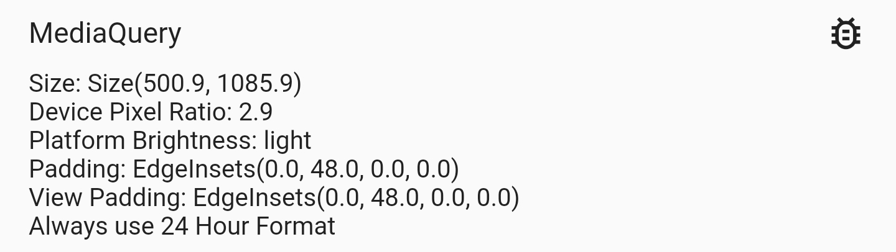
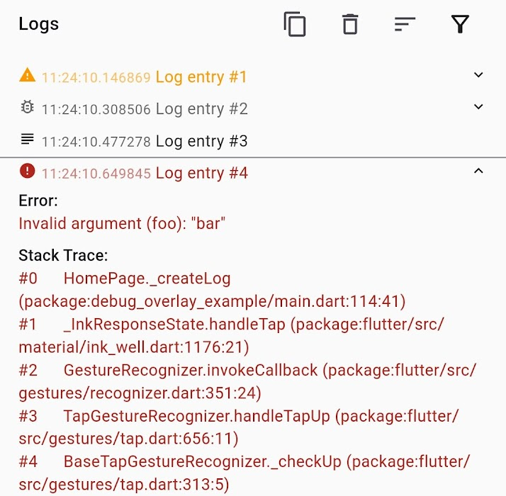
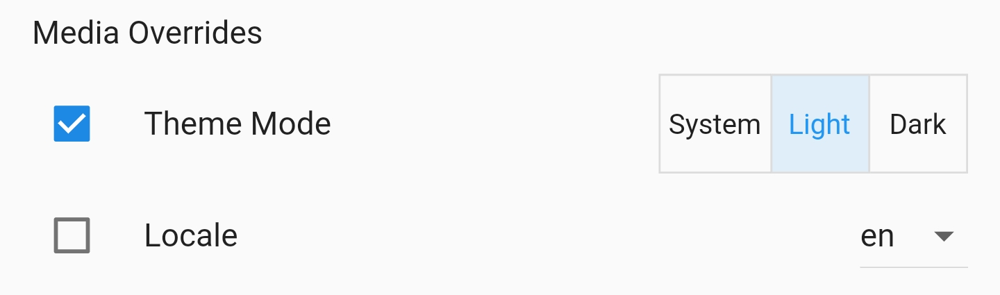

# debug_overlay

🐛 View debug infos and change settings via a central overlay for your app.


To add a debug overlay to your app, pass `DebugOverlay.builder()` to `MaterialApp`/`CupertinoApp`/`WidgetsApp.builder`:

```dart
MaterialApp(
  builder: DebugOverlay.builder(),
  // And other customization...
)
```

> The debug overlay only works in debug mode and is not included in your widget tree in profile or release mode unless you pass `enableOnlyInDebugMode: false`.

The overlay has three modes (`DebugOverlayMode`):

- `closed`: Nothing is visible (the default).
- `collapsed`: Only a draggable bubble is visible. Tap it to expand the overlay, or drag it onto the target at the bottom to close the overlay.
- `expanded`: The sheet with all debug helpers is visible.

To open the overlay, press and hold two fingers on the screen (or press <kbd>Alt</kbd> + <kbd>F12</kbd> on a platform with a keyboard).
You can change or disable these triggers via `DebugOverlay.builder(trigger: ...)`, e.g., `DebugOverlayTrigger.none`.

To control the overlay from code, use `DebugOverlay.expand()`, `DebugOverlay.collapse()`, and `DebugOverlay.close()`.
You can read and listen to the current mode via `DebugOverlay.mode`, which is a `ValueNotifier` that you can also set before `runApp` to start in a different mode.

By default, this overlay includes `MediaQueryDebugHelper` and `RenderingDebugHelper`.
More tools are available in the [additional packages](#additional-packages) below.

## Additional Packages

Helpers that need additional dependencies live in separate packages, so you only pay for what you use:

| Package                                                                                                                      | Contents                                                                                                           |
| ---------------------------------------------------------------------------------------------------------------------------- | ------------------------------------------------------------------------------------------------------------------ |
| [`debug_overlay_device_info_plus`](https://github.com/JonasWanke/debug_overlay/tree/main/debug_overlay_device_info_plus)     | `DeviceInfoDebugHelper` (uses [<kbd>device_info_plus</kbd>](https://pub.dev/packages/device_info_plus))            |
| [`debug_overlay_file_browser`](https://github.com/JonasWanke/debug_overlay/tree/main/debug_overlay_file_browser)             | `FileBrowserDebugHelper` (uses [<kbd>path_provider</kbd>](https://pub.dev/packages/path_provider))                 |
| [`debug_overlay_http`](https://github.com/JonasWanke/debug_overlay/tree/main/debug_overlay_http)                             | `DebugHttpClient` for the network inspector                                                                        |
| [`debug_overlay_dio`](https://github.com/JonasWanke/debug_overlay/tree/main/debug_overlay_dio)                               | `DebugDioInterceptor` for the network inspector                                                                    |
| [`debug_overlay_package_info_plus`](https://github.com/JonasWanke/debug_overlay/tree/main/debug_overlay_package_info_plus)   | `PackageInfoDebugHelper` (uses [<kbd>package_info_plus</kbd>](https://pub.dev/packages/package_info_plus))         |
| [`debug_overlay_shared_preferences`](https://github.com/JonasWanke/debug_overlay/tree/main/debug_overlay_shared_preferences) | `SharedPreferencesDebugHelper` (uses [<kbd>shared_preferences</kbd>](https://pub.dev/packages/shared_preferences)) |

## Debug Tools & Helpers

Each tab of the expanded overlay is a `DebugTool`: an icon, a title (shown as tooltip), and a sliver widget with the content, usually a debug helper from below.
To add a tool, register it by calling either of the following:

- `DebugOverlay.prependTool(myDebugTool)` to add it to the front of the list
- `DebugOverlay.appendTool(myDebugTool)` to add it to the end of the list

Or, if you want to override all currently registered tools, set `DebugOverlay.tools.value` to a list of `DebugTool`s.

Every built-in helper below provides a ready-made tool via `tool`, e.g., `DebugOverlay.appendTool(LogsDebugHelper.tool(logs))`.
The helper widgets themselves are public too, so you can, for example, use a different icon or title (`DebugTool(icon: ..., title: ..., sliver: LogsDebugHelper(logs))`) or combine several helpers in one tool.

### `MediaQueryDebugHelper`



Displays information obtained from [`MediaQuery`](https://api.flutter.dev/flutter/widgets/MediaQuery-class.html).

### `LogsDebugHelper`



Displays logs generated by your app. To use it, follow these steps:

1. Store its mutable state, e.g., in a global variable:

   ```dart
   final logs = LogCollection(
     // Default values:
     maximumSize: 500,
     onlyStoreLogsInDebugMode: true,
   );
   ```

2. Register the helper and supply its state, e.g., in `main()`:

   ```dart
   void main() {
     if (kDebugMode) {
       DebugOverlay.appendTool(LogsDebugHelper.tool(logs));
     }

     runApp(MyApp());
   }
   ```

3. When you generate logs, add them to the collection.
   Except for `message`, all parameters are optional:

   ```dart
   logs.add(Log(
     level: DiagnosticLevel.info,
     timestamp: DateTime.now(),
     message: 'My message',
     error: myException,
     stackTrace: myStackTrace,
   ));
   ```

The `error` field can also hold data for non-error logs.
If it stores JSON data (on an object with a `toJson()` method), the data can be inspected using [<kbd>json_view</kbd>](https://pub.dev/packages/json_view).

### `MediaOverridesDebugHelper`



This allows you to override the theme mode and locale of your app. To use it, follow these steps:

1. Store its mutable state, e.g., in a global variable:

   ```dart
   final mediaOverrideState = ValueNotifier(MediaOverrideState());
   ```

2. Register the helper and supply its state, e.g., in `main()`:

   ```dart
   void main() {
     if (kDebugMode) {
       DebugOverlay.prependTool(MediaOverrideDebugHelper.tool(
         mediaOverrideState,
         // To support overriding locales, this value must be set and should
         // contain the same locales as passed to [MaterialApp.supportedLocales],
         // [CupertinoApp.supportedLocales] or [WidgetsApp.supportedLocales].
         supportedLocales: supportedLocales,
       ));
     }

     runApp(MyApp());
   }
   ```

3. When building your `MaterialApp`/`CupertinoApp`/`WidgetsApp`, wrap it in a `ValueListenableBuilder` that uses the state from step 1:

   ```dart
   ValueListenableBuilder<MediaOverrideState>(
     valueListenable: mediaOverrideState,
     builder: (context, overrideState, child) {
       return MaterialApp(
         // You can access overridden values via [overrideState]:
         themeMode: overrideState.themeMode,
         locale: overrideState.locale,

         builder: DebugOverlay.builder(),
         supportedLocales: supportedLocales,

         // And your other customizations...
       );
     },
   );
   ```

<!--  -->

### `NetworkDebugHelper`

Lists HTTP requests with their status, duration, headers, and bodies. To use it, follow these steps:

1. Store its state, e.g., in a global variable:

   ```dart
   final networkRequests = NetworkRequestCollection(
     // Default values:
     maximumSize: 200,
     onlyStoreRequestsInDebugMode: true,
   );
   ```

2. Register the helper, e.g., in `main()`:

   ```dart
   DebugOverlay.appendTool(NetworkDebugHelper.tool(networkRequests));
   ```

3. Record requests using one of the following:

   - [`debug_overlay_http`](https://github.com/JonasWanke/debug_overlay/tree/main/debug_overlay_http): `DebugHttpClient` for [`http`](https://pub.dev/packages/http)
   - [`debug_overlay_dio`](https://github.com/JonasWanke/debug_overlay/tree/main/debug_overlay_dio): `DebugDioInterceptor` for [`dio`](https://pub.dev/packages/dio)
   - Any other client: call `networkRequests.start(...)`, `complete(...)`, and `fail(...)` manually.

### Custom

To implement your own debug tool, wrap a sliver in a `DebugTool`. You can use the provided `DebugHelper` class for the layout.

If your information can be represented with Flutter's [`DiagnosticsNode`](https://api.flutter.dev/flutter/foundation/DiagnosticsNode-class.html), you can use `DiagnosticsBasedDebugHelper` which automatically provides filtering.
This is also used internally by `DeviceInfoDebugHelper` (from `debug_overlay_device_info_plus`), `MediaQueryDebugHelper`, and `PackageInfoDebugHelper` (from `debug_overlay_package_info_plus`).
