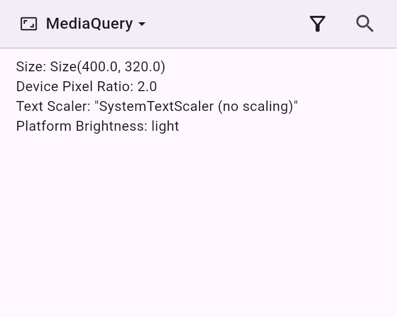
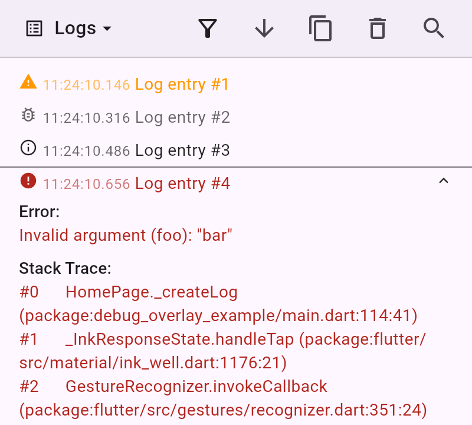
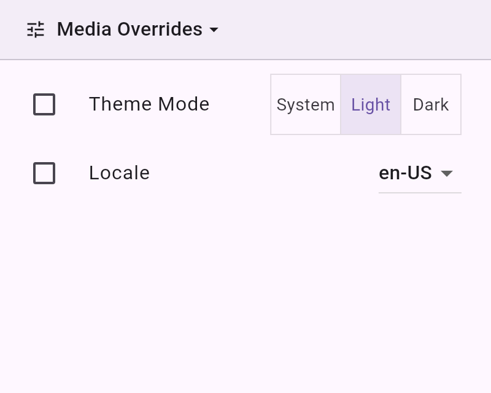
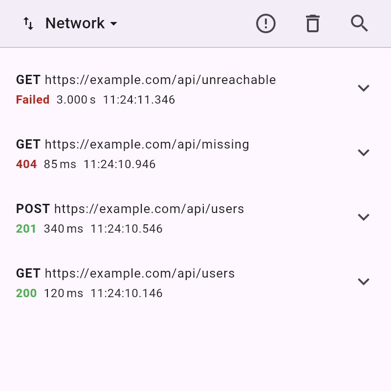
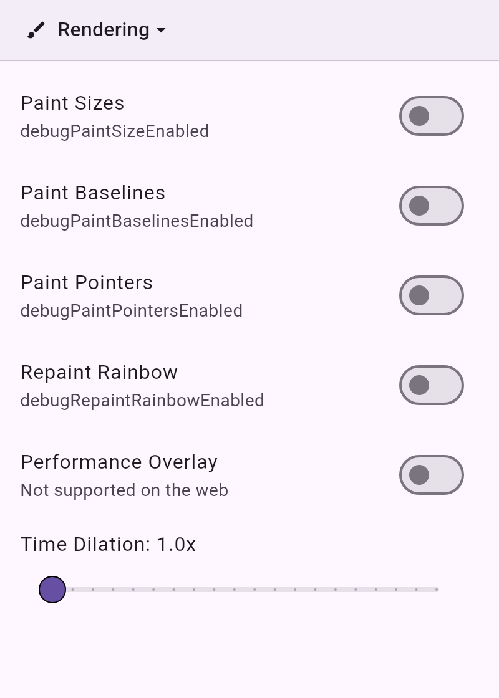

# debug_overlay

🐛 View debug infos and change settings via a central overlay for your app.

To add a debug overlay to your app, pass `DebugOverlay.builder()` to `MaterialApp`/`CupertinoApp`/`WidgetsApp.builder`:

```dart
MaterialApp(
  builder: DebugOverlay.builder(),
  // And other customization...
)
```

> The debug overlay only works in debug mode and is not included in your widget tree in profile or release mode unless you pass `enableOnlyInDebugMode: false`.

The overlay has three modes (`DebugOverlayMode`):

- `closed`: Nothing is visible (the default).
- `collapsed`: Only a draggable bubble is visible. Tap it to expand the overlay, or drag it onto the target at the bottom to close the overlay.
- `expanded`: The sheet with all debug helpers is visible.

To open the overlay, press and hold two fingers on the screen (or press <kbd>Alt</kbd> + <kbd>F12</kbd> on a platform with a keyboard).
You can change or disable these triggers via `DebugOverlay.builder(trigger: ...)`, e.g., `DebugOverlayTrigger.none`.

To control the overlay from code, use `DebugOverlay.expand()`, `DebugOverlay.collapse()`, and `DebugOverlay.close()`.
You can read and listen to the current mode via `DebugOverlay.mode`, which is a `ValueNotifier` that you can also set before `runApp` to start in a different mode.

By default, this overlay includes `MediaQueryDebugTool` and `RenderingDebugTool`.
More tools are available in the [additional packages](#additional-packages) below.

## Additional Packages

Tools that need additional dependencies live in separate packages:

| Package                                                                                                                      | Contents                                                                                                         |
| ---------------------------------------------------------------------------------------------------------------------------- | ---------------------------------------------------------------------------------------------------------------- |
| [`debug_overlay_device_info_plus`](https://github.com/JonasWanke/debug_overlay/tree/main/debug_overlay_device_info_plus)     | `DeviceInfoDebugTool` (uses [<kbd>device_info_plus</kbd>](https://pub.dev/packages/device_info_plus))            |
| [`debug_overlay_file_browser`](https://github.com/JonasWanke/debug_overlay/tree/main/debug_overlay_file_browser)             | `FileBrowserDebugTool` (uses [<kbd>path_provider</kbd>](https://pub.dev/packages/path_provider))                 |
| [`debug_overlay_http`](https://github.com/JonasWanke/debug_overlay/tree/main/debug_overlay_http)                             | `DebugHttpClient` for the network inspector (uses [<kbd>http</kbd>](https://pub.dev/packages/http))              |
| [`debug_overlay_dio`](https://github.com/JonasWanke/debug_overlay/tree/main/debug_overlay_dio)                               | `DebugDioInterceptor` for the network inspector (uses [<kbd>dio</kbd>](https://pub.dev/packages/dio))            |
| [`debug_overlay_package_info_plus`](https://github.com/JonasWanke/debug_overlay/tree/main/debug_overlay_package_info_plus)   | `PackageInfoDebugTool` (uses [<kbd>package_info_plus</kbd>](https://pub.dev/packages/package_info_plus))         |
| [`debug_overlay_shared_preferences`](https://github.com/JonasWanke/debug_overlay/tree/main/debug_overlay_shared_preferences) | `SharedPreferencesDebugTool` (uses [<kbd>shared_preferences</kbd>](https://pub.dev/packages/shared_preferences)) |

## Debug Tools

Each entry in the tool picker of the expanded overlay is a `DebugTool`: an icon, a title, optional actions, and a sliver with the content.
The header shows the active tool's icon and title; tap it to switch tools via a grid of all tools.
The tool's actions appear in the header next to the title.

To add a tool, register it by calling either of the following:

- `DebugOverlay.prependTool(myDebugTool)` to add it to the front of the list
- `DebugOverlay.appendTool(myDebugTool)` to add it to the end of the list

Or, if you want to override all currently registered tools, set `DebugOverlay.tools.value` to a list of `DebugTool`s.

Every built-in tool below is a class that you instantiate, e.g., `DebugOverlay.appendTool(LogsDebugTool(logs))`.
Tools own their state, so filters and similar settings survive switching to another tool or closing the overlay.

### `MediaQueryDebugTool`



Displays information obtained from [`MediaQuery`](https://api.flutter.dev/flutter/widgets/MediaQuery-class.html).

### `LogsDebugTool`



Displays logs generated by your app. To use it, follow these steps:

1. Store its mutable state, e.g., in a global variable:

   ```dart
   final logs = LogCollection(
     // Default values:
     maximumSize: 500,
     onlyStoreLogsInDebugMode: true,
   );
   ```

2. Register the tool and supply its state, e.g., in `main()`:

   ```dart
   void main() {
     if (kDebugMode) {
       DebugOverlay.appendTool(LogsDebugTool(logs));
     }

     runApp(MyApp());
   }
   ```

3. When you generate logs, add them to the collection.
   Except for `message`, all parameters are optional:

   ```dart
   logs.add(Log(
     level: DiagnosticLevel.info,
     timestamp: DateTime.now(),
     message: 'My message',
     error: myException,
     stackTrace: myStackTrace,
   ));
   ```

The `error` field can also hold data for non-error logs.
If it stores JSON data (on an object with a `toJson()` method), the data can be inspected using [<kbd>json_view</kbd>](https://pub.dev/packages/json_view).

### `MediaOverrideDebugTool`



This allows you to override the theme mode and locale of your app. To use it, follow these steps:

1. Store its mutable state, e.g., in a global variable:

   ```dart
   final mediaOverrideState = ValueNotifier(MediaOverrideState());
   ```

2. Register the tool and supply its state, e.g., in `main()`:

   ```dart
   void main() {
     if (kDebugMode) {
       DebugOverlay.prependTool(MediaOverrideDebugTool(
         mediaOverrideState,
         // To support overriding locales, this value must be set and should
         // contain the same locales as passed to [MaterialApp.supportedLocales],
         // [CupertinoApp.supportedLocales] or [WidgetsApp.supportedLocales].
         supportedLocales: supportedLocales,
       ));
     }

     runApp(MyApp());
   }
   ```

3. When building your `MaterialApp`/`CupertinoApp`/`WidgetsApp`, wrap it in a `ValueListenableBuilder` that uses the state from step 1:

   ```dart
   ValueListenableBuilder<MediaOverrideState>(
     valueListenable: mediaOverrideState,
     builder: (context, overrideState, child) {
       return MaterialApp(
         // You can access overridden values via [overrideState]:
         themeMode: overrideState.themeMode,
         locale: overrideState.locale,

         builder: DebugOverlay.builder(),
         supportedLocales: supportedLocales,

         // And your other customizations...
       );
     },
   );
   ```

<!--  -->

### `NetworkDebugTool`



Lists HTTP requests with their status, duration, headers, and bodies. To use it, follow these steps:

1. Store its state, e.g., in a global variable:

   ```dart
   final networkRequests = NetworkRequestCollection(
     // Default values:
     maximumSize: 200,
     onlyStoreRequestsInDebugMode: true,
   );
   ```

2. Register the tool, e.g., in `main()`:

   ```dart
   DebugOverlay.appendTool(NetworkDebugTool(networkRequests));
   ```

3. Record requests using one of the following:

   - [`debug_overlay_http`](https://github.com/JonasWanke/debug_overlay/tree/main/debug_overlay_http): `DebugHttpClient` for [`http`](https://pub.dev/packages/http)
   - [`debug_overlay_dio`](https://github.com/JonasWanke/debug_overlay/tree/main/debug_overlay_dio): `DebugDioInterceptor` for [`dio`](https://pub.dev/packages/dio)
   - Any other client: call `networkRequests.start(...)`, `complete(...)`, and `fail(...)` manually.

### `RenderingDebugTool`



Toggles Flutter's debug paint flags (sizes, baselines, pointers, repaint rainbow) and the performance overlay, offers a slider for `timeDilation`, and controls the system UI (status bar, navigation bar, and `SystemUiMode`). Register it via `DebugOverlay.appendTool(RenderingDebugTool())`.

Most options only work in debug mode.

### Custom

To implement your own debug tool, extend `DebugTool`.
It is a [`ChangeNotifier`](https://api.flutter.dev/flutter/foundation/ChangeNotifier-class.html) that owns its state, so call `notifyListeners()` after changing anything that affects its actions or content:

```dart
class MyDebugTool extends DebugTool {
  MyDebugTool() : super(icon: Icons.bolt, title: 'My Tool');

  var _isEnabled = false;

  @override
  List<DebugToolAction> buildActions(BuildContext context) {
    return [
      DebugToolButton(
        icon: Icons.power_settings_new,
        label: 'Toggle',
        isSelected: _isEnabled,
        onPressed: () {
          _isEnabled = !_isEnabled;
          notifyListeners();
        },
      ),
    ];
  }

  @override
  Widget buildSliver(BuildContext context) {
    return SliverToBoxAdapter(child: Text('Enabled: $_isEnabled'));
  }
}
```

Actions are `DebugToolButton`s (optionally a toggle via `isSelected`) or `DebugToolChoice`s that let the user pick one of several options.
They are icon buttons in the header; if there isn't enough space, the last ones move into an overflow menu that shows their labels, so put the most important actions first.

To make your tool searchable, override `isSearchable` to return `true` and only show entries for which `matchesSearch(text)` is `true` in `buildSliver`.
The header then shows a search button and field, and the query is stored in the tool (`searchQuery`).

The overlay never disposes tools; if you create them dynamically, call `dispose()` after removing them from `DebugOverlay.tools`.

If your information can be represented with Flutter's [`DiagnosticsNode`](https://api.flutter.dev/flutter/foundation/DiagnosticsNode-class.html), you can extend `DiagnosticsBasedDebugTool` which automatically provides filtering.
This is also used internally by `DeviceInfoDebugTool` (from `debug_overlay_device_info_plus`), `MediaQueryDebugTool`, and `PackageInfoDebugTool` (from `debug_overlay_package_info_plus`).
