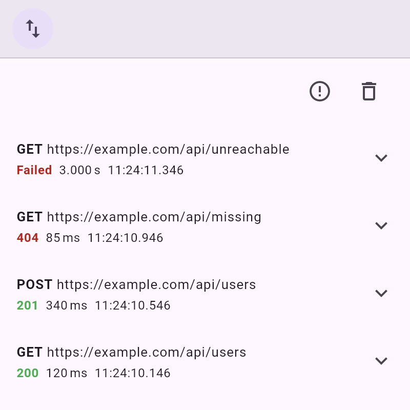

# debug_overlay_dio

Records requests of [`dio`](https://pub.dev/packages/dio) in the `debug_overlay` network inspector.



Part of [<kbd>debug_overlay</kbd>](https://pub.dev/packages/debug_overlay).

## Usage

```dart
final networkRequests = NetworkRequestCollection();
final dio = Dio()..interceptors.add(DebugDioInterceptor(networkRequests));

DebugOverlay.appendTool(NetworkDebugHelper.tool(networkRequests));
```

Add the interceptor after interceptors that modify requests or responses, so that it records what is actually sent and received.
