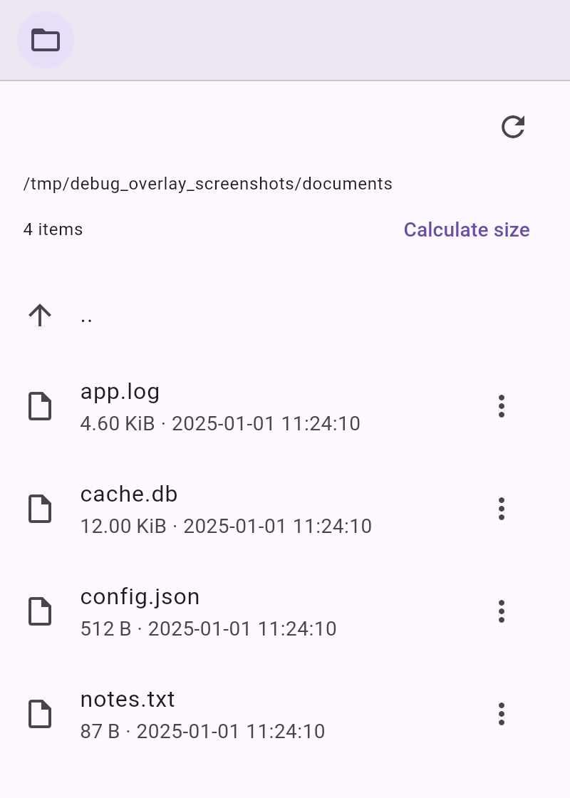

# debug_overlay_file_browser

Browse, preview, and delete files in the app's private storage directories (documents, support, temporary, cache, and platform-specific ones) in the `debug_overlay`.



Part of [<kbd>debug_overlay</kbd>](https://pub.dev/packages/debug_overlay).

## Usage

```dart
DebugOverlay.appendTool(FileBrowserDebugHelper.tool());
```

To browse other directories instead of the ones provided by [<kbd>path_provider</kbd>](https://pub.dev/packages/path_provider), pass `roots`:

```dart
FileBrowserDebugHelper.tool(
  roots: [FileBrowserRoot(name: 'Logs', directory: Directory(logsPath))],
)
```

Files are previewed as text (JSON is pretty-printed), image, or hex dump. Deleting always asks for confirmation.

This tool stays empty on the web.
