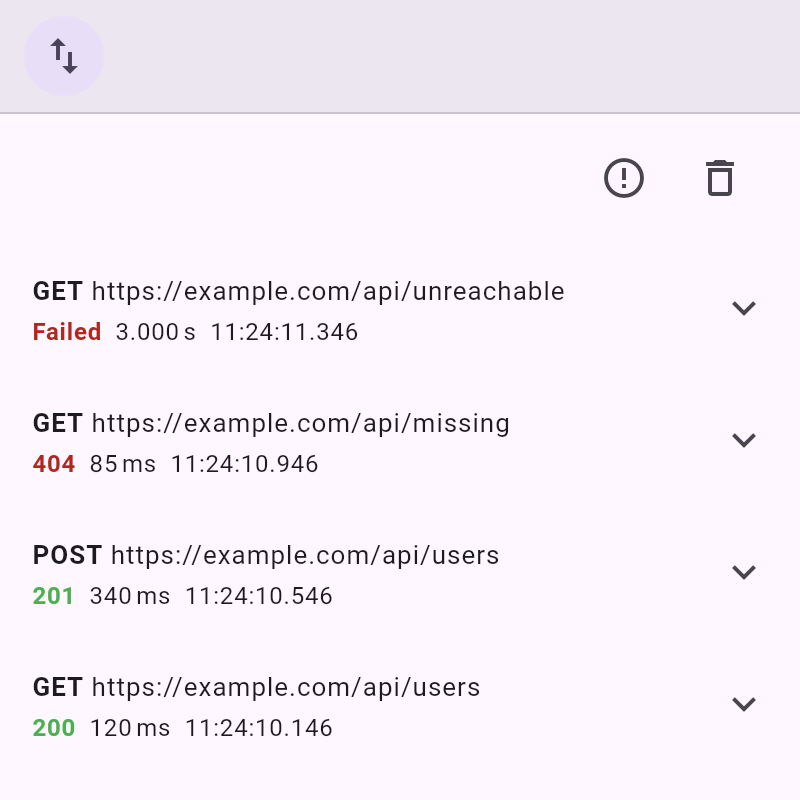

# debug_overlay_http

Records requests of the [`http`](https://pub.dev/packages/http) package in the `debug_overlay` network inspector.



Part of [<kbd>debug_overlay</kbd>](https://pub.dev/packages/debug_overlay).

## Usage

```dart
final networkRequests = NetworkRequestCollection();
final client = DebugHttpClient(networkRequests); // Optionally pass `inner:`.

DebugOverlay.appendTool(NetworkDebugHelper.tool(networkRequests));
```
