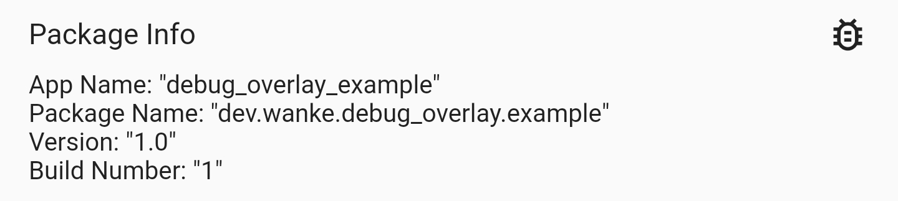

# debug_overlay_package_info_plus

Displays information obtained from [<kbd>package_info_plus</kbd>](https://pub.dev/packages/package_info_plus) in the `debug_overlay`.



Part of [<kbd>debug_overlay</kbd>](https://pub.dev/packages/debug_overlay).

## Usage

```dart
DebugOverlay.appendTool(PackageInfoDebugHelper.tool);
```
