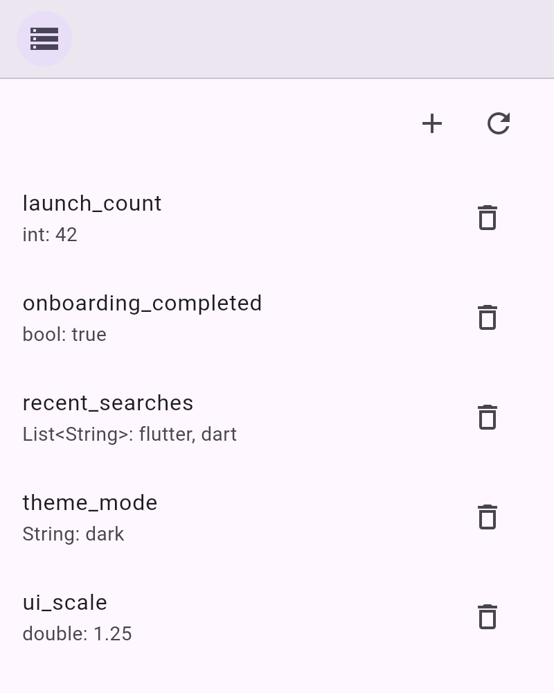

# debug_overlay_shared_preferences

Lists all entries of [<kbd>shared_preferences</kbd>](https://pub.dev/packages/shared_preferences) with their types and lets you edit, add, and delete them.



Part of [<kbd>debug_overlay</kbd>](https://pub.dev/packages/debug_overlay).

## Usage

```dart
DebugOverlay.appendTool(SharedPreferencesDebugHelper.tool());
```

Optionally pass your own `SharedPreferencesAsync` instance to `tool(...)`.
